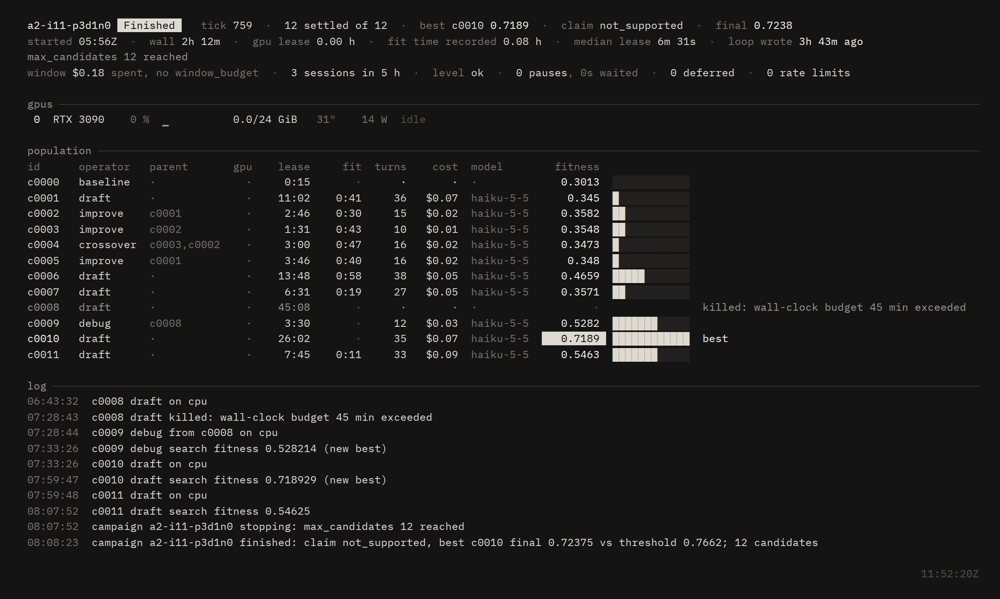

<p align="center">
  
</p>

<h1>
  <picture>
    <source media="(prefers-color-scheme: dark)" srcset="docs/assets/labloop-plate-dark.svg">
    <source media="(prefers-color-scheme: light)" srcset="docs/assets/labloop-plate-light.svg">
    
  </picture>
  Labloop
</h1>

A research harness for coding agents.

| | |
|---|---|
| Kind | Artifact of [Nullsilver](https://nullsilver.com/artifacts/labloop) |
| Status | Released 07 Aug 2026, still experimental |
| Sessions | Claude Code, or Pi for open models |
| Records | [`FORMAT.json`](FORMAT.json), version 2.2 |
| License | MIT |

A coding agent can write an experiment and run it, but a research campaign needs more than that. Someone has to choose what to try next, keep the work inside its budget, and score every result the same way. Labloop does those parts and leaves the code to the agent.

A campaign starts from a configuration you write: the task, a trivial baseline, an evaluator, the budgets, and the score that would count as success. Labloop then runs a loop. It picks a candidate to build on, gives a short agent session the job of making a new one, scores the result on a search split whose labels the agent can't read, records it, and picks again. The sessions run in Claude Code, or in [Pi](https://pi.dev) when the campaign uses a local or hosted open model. Labloop is the only thing that writes the campaign's records.

The search scores decide which candidates get pursued, so the best of them is optimistic by construction. When the campaign ends, Labloop runs the chosen candidate once on a separate final split and compares that one score with the threshold, which was fixed before the search began. Failed, invalid and interrupted candidates stay in the record with their configuration and the reason they stopped.

The design follows AIRA₂ (Meta FAIR, arXiv 2603.26499). We added what it takes to run it on one machine with a subscription: jobs supervised under time and usage budgets, records on the filesystem that survive a restart, labels the operating system can hide from the agent, and a governor that treats the subscription's rolling usage window as a budget of its own. The state of the work is in [NEXT.md](NEXT.md), and the rules an agent follows in this repository are in [CLAUDE.md](CLAUDE.md).

## What running it has shown

We've used Labloop to study itself. On generated tasks with a hidden structure to find, we compared versions of the harness that differed in one respect, and wrote down the decision rule for each comparison before running it.

The largest effect came from the instructions each agent session receives, not from the search algorithm. The old instructions asked every improvement step to "make one hypothesised change" and every fresh attempt to "prefer simple and runnable over ambitious". With those two sentences removed, improvement steps found new hidden structure in 21 of 160 jobs, against 4 of 160 with them, and the final scores rose in two independent runs. Neither run settled the question on its own. Together, the sixteen paired campaigns cleared the threshold we had set in advance for combining them, so we changed the default instructions.

Two other ideas didn't hold up. Spending more of a campaign on fresh attempts helped a little, but across thirty-two campaigns the gain couldn't be told apart from noise. Asking agents to check that their change had any effect removed the steps that changed nothing, and didn't lead to more discoveries. The plan, the reviews and every result, the failed ones included, are in [docs/labloop-v2-plan.md](docs/labloop-v2-plan.md).

## Running a campaign

1. Create a project with `tools/lab campaign init <id>`. It writes `campaign.toml`, `task.md`, an evaluator, a baseline and the data directories.
2. Write the task statement, the evaluator and the baseline. The evaluator is a small Python script that reads predictions and labels and prints a score. The labels of the search and final splits stay outside the repository, under `$LAB_PRIVATE`.
3. Fix the success threshold in `campaign.toml` before you run anything. If you change the configuration later, that's a new campaign.
4. Open `claude` once in the campaign directory and accept the trust dialog. Labloop won't start in a directory Claude Code doesn't trust, because the agent sessions there would ignore the project's permissions.
5. Check the configuration and start the loop under a watcher:

   ```sh
   export LAB_PRIVATE=~/.local/share/labloop-private
   tools/lab campaign check
   tools/lab watch start --op campaign --budget-min 1500 -- tools/lab run campaign.toml
   tools/lab campaign status
   ```

6. When the campaign ends, `REPORT.md` gives the baseline, the best candidate from the search, the single final score against the threshold, and what the campaign used.



The status view shows the claim and the final score, the usage window, and every candidate with its parents, its time, its cost, the model that answered and its search score, both while a campaign runs and after it ends. In the campaign above, one attempt was stopped at its time limit, the repair after it recovered it, and a later attempt became the best.

The rest of the setup is in [docs/campaign-setup.md](docs/campaign-setup.md): the Python environment for candidates, the optional `labeval` user that hides labels at the operating-system level, local models, and every configuration key. [nullsilver.com/labloop/inputs](https://nullsilver.com/labloop/inputs) lists every input a campaign is given and which part of the loop reads it. `scripts/acceptance.sh` runs the whole loop with scripted agents, so you can test it before any model is involved.

## How the loop works

Each step of the loop settles the jobs that have finished, enforces the budgets, starts new jobs while there is room, and checks whether the campaign should stop. The baseline runs first, then one or more fresh attempts. After that, each new job improves on a candidate chosen by rank, combines two candidates, or repairs one that failed. When the campaign stops, Labloop freezes the best candidate by search score, runs it once on the final split and writes the report. If the loop is interrupted, you can start it again. It resumes from its records, and a job that was lost is recorded as lost.

Each agent session gets a job card with its instructions, the task, what it may read and write, its parents' code and summaries, and the scores so far. The instructions turned out to matter more than the selection rule, so a campaign can change them without changing the code. A campaign can also set how much of it goes to fresh attempts, when a stalled line of work gives way to a new one, and whether it starts from a copy of another campaign's opening, so that two variants of an experiment begin from the same candidates.

The model named in the configuration decides which harness runs a session. A Claude model runs through Claude Code on the subscription, and a model written as `provider/model` runs through Pi, against a local server or any compatible API. Both follow the same contract, and one campaign can use both.

## The records

You own the campaign's configuration, task statement, evaluator and baseline, and Labloop never edits them. Labloop owns everything it records: one directory per candidate with its code, its job card, its summary and its score, the campaign's live state in `population.json`, a ledger with one row per candidate, an append-only event feed, and the final report. Nothing in the records is deleted, because a failed or interrupted candidate is evidence too. A hook stops agents from editing them, but code an agent writes and runs isn't inspected, so the hook can be got around.

The records follow a published format, described in `FORMAT.json`. It's versioned, so a reader can always tell which rules applied to a given file or event. [nullsilver.com](https://nullsilver.com) renders campaigns straight from these records. The event feed is written to be public as it is: its messages are short, its size is capped, and known kinds of secrets are removed before anything is written.

<details>
<summary>The command line</summary>

```
lab campaign init <id> | check | status | usage [--json] | stop [--now]
lab run [campaign.toml] [--once --poll-sec N]
lab candidate list
lab eval <candidate dir> [--split search]       the only reader of labels; never the final split on request
lab job card <candidate dir>                     the instructions a session receives
lab watch start --op NAME --budget-min N [--stall-min N --kill-regex RE] -- <cmd>
lab watch list | check | kill <id> --reason … | close <id>
lab log <type> --msg "…" [--data '{…}'] [--candidate <id>]
lab events tail -n 20 [--class news|activity]
lab usage [--since YYYY-MM-DD] [--json]
lab validate
lab format show | sync | version
```

</details>

<details>
<summary>Format versions</summary>

The major version changes when a reader that ignored the change would misread the data. The minor version changes for additions a reader can safely ignore.

| version | change |
|---|---|
| 1.0 | the initial contract: a six-phase state machine with trials and gates |
| 1.1 | which model was requested and which one answered |
| 1.2 | the `note` event |
| 1.3 | the `trial.verdict` event |
| 1.4 | the campaign loop's events beside the phase vocabulary |
| 2.0 | the phase machine is removed; `population.json` is the live state, and events name a campaign and a candidate |
| 2.1 | optional finding cards, written once per candidate |
| 2.2 | seeded campaigns, and a record of steps whose output matched their parent's |

</details>

## License

MIT, see `LICENSE`.
