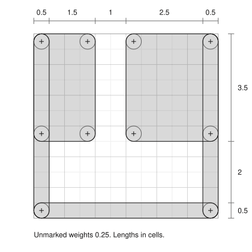

<p align="center">
  <picture>
    <source media="(prefers-color-scheme: dark)" srcset="docs/assets/labloop-plate-dark.svg">
    <source media="(prefers-color-scheme: light)" srcset="docs/assets/labloop-plate-light.svg">
    
  </picture>
</p>

# Labloop

Coding agents can write and run experiments, but this alone is not enough to conduct a research campaign: someone still needs to decide which experiments to try next, keep the work within its budgets, and ensure that every result is evaluated in the same way. Labloop provides the tooling around the agent that handles these tasks.

A campaign starts from a configuration written by a person: the task, a trivial baseline, an evaluator, the available budgets, and a success threshold. Labloop then runs a loop. It chooses a candidate to build on, gives a short agent session the job of producing a new candidate, scores the result on a hidden search split, records it, and chooses again. The agent sessions run in Claude Code, or in [Pi](https://pi.dev) when the campaign uses a local or hosted open model; Labloop manages the search around them and is the only writer of the campaign's records.

Crucially, a good score during the search is not sufficient to support a claim. The search scores decide which candidates to pursue, so they are optimistic by construction. When the campaign ends, the selected candidate is therefore evaluated once on a separate final split, and that single result is compared against the threshold fixed before the search began. Failed, invalid and interrupted candidates remain in the record with their configurations and reasons. The intention is to preserve what actually happened, rather than only the attempts that worked.

The design follows AIRA₂ (Meta FAIR, arXiv 2603.26499), with the additions needed to run it on a single machine with a subscription: supervised jobs with time and usage budgets, records on the filesystem that survive a restart, labels that the operating system can hide from the agent, and a governor that treats the subscription's rolling usage window as a limited resource. Labloop is still experimental. The current state of the work is in [NEXT.md](NEXT.md), and the rules an agent working in this repository follows are in [CLAUDE.md](CLAUDE.md).

## What running it has shown

Labloop has also been used to study itself. Using small, cheap agents on generated tasks with hidden structure, we compared versions of the harness that differed in a single respect, with the decision rule for each comparison written down before it ran.

The clearest result concerned the instructions given to each agent session, rather than the search algorithm. The original instructions asked each improvement step to "make one hypothesised change" and each new attempt to "prefer simple and runnable over ambitious". Without those two sentences, improvement steps discovered new hidden structure about five times as often (21 of 160 jobs, against 4 of 160), and the final scores rose in two independent runs. Neither run was conclusive on its own; together, the sixteen paired campaigns cleared the threshold set in advance for combining them. The default instructions have changed accordingly.

Other ideas did not hold up. Spending more of a campaign on fresh attempts helped slightly, but too little to distinguish from noise across thirty-two campaigns. Telling agents to check that their change had any effect removed the steps that changed nothing, but did not lead to more discoveries. Whether a crossover step can combine what two earlier candidates found is the question currently being tested. The plan, the reviews and every result, including the ones that failed, are in [docs/labloop-v2-plan.md](docs/labloop-v2-plan.md).

## Running a campaign

1. Create a project with `tools/lab campaign init <id>`. This writes `campaign.toml`, `task.md`, an evaluator, a baseline and the data directories.
2. Write the task statement, the evaluator and the baseline. The evaluator is a small Python script that reads predictions and labels and prints a score. The labels of the search and final splits stay outside the repository, under `$LAB_PRIVATE`.
3. Fix the success threshold in `campaign.toml` before running anything. Changing the configuration later starts a new campaign.
4. Open `claude` once in the campaign directory and accept the trust dialog. Labloop refuses to start in a directory Claude Code does not trust, since the agent sessions there would ignore the project's permissions.
5. Check the configuration and start the loop under a watcher:

   ```sh
   export LAB_PRIVATE=~/.local/share/labloop-private
   tools/lab campaign check
   tools/lab watch start --op campaign --budget-min 1500 -- tools/lab run campaign.toml
   tools/lab campaign status
   ```

6. When the campaign ends, `REPORT.md` states the baseline, the best candidate found during the search, the single final score against the threshold, and what the campaign used.


The status view shows a campaign as it runs and after it ends: the claim and the final score, the usage window, and every candidate with its parents, its time, its cost, the model that answered and its search score. In the campaign above, one attempt was stopped at its time limit, the repair that followed recovered it, and a later attempt became the best.

The remaining setup, including the Python environment for candidates, the optional `labeval` user that hides labels at the operating-system level, local models, and every configuration key, is described in [docs/campaign-setup.md](docs/campaign-setup.md). `scripts/acceptance.sh` exercises the whole loop with scripted agents before any model is involved.

## How the loop works

Each step of the loop settles the jobs that have finished, enforces the budgets, starts new jobs while there is room, and checks whether the campaign should stop. The baseline runs first, followed by one or more fresh attempts. After that, each new job either improves on a candidate chosen by rank, combines two candidates, or repairs one that failed. Stopping freezes the best candidate by search score, runs it once on the final split, and writes the report. A loop that is interrupted can simply be started again: it resumes from its records, and a job that was lost is recorded as such.

Each agent session receives a job card: its instructions, the task, what it may read and write, its parents' code and summaries, and the scores so far. Because these instructions turned out to matter more than the selection rule, they can be changed per campaign without changing the code. The same is true of how much of a campaign goes to fresh attempts, when a stalled line of work should give way to a new one, and whether a campaign should start from a copy of another campaign's opening, so that two variants of an experiment begin from identical candidates.

The model named in the configuration decides which harness runs a session. A Claude model runs through Claude Code on the subscription; a model of the form `provider/model` runs through Pi, against a local server or any compatible API. Both work under the same contract, and the two can be mixed within one campaign.

## The records

The person running a campaign owns its configuration, task statement, evaluator and baseline; Labloop never edits them. Labloop owns everything it records: one directory per candidate with its code, its job card, its summary and its score, along with the campaign's live state (`population.json`), a ledger with one row per candidate, an append-only event feed, and the final report. These records are never deleted, because a failed or interrupted candidate is also evidence. A hook prevents agents from editing them, although it is a safeguard rather than a sandbox: code an agent writes and runs is not inspected.

The records follow a published format, described in `FORMAT.json` and versioned so that a reader can always tell which rules applied to a given file or event. A site such as [nullsilver.com](https://nullsilver.com) can render a campaign directly from them. The event feed is written to be public as it is: its messages are short, its size is capped, and known kinds of secrets are removed before anything is written.

<details>
<summary>The command line</summary>

```
lab campaign init <id> | check | status | usage [--json] | stop [--now]
lab run [campaign.toml] [--once --poll-sec N]
lab candidate list
lab eval <candidate dir> [--split search]       the only reader of labels; never the final split on request
lab job card <candidate dir>                     the instructions a session receives
lab watch start --op NAME --budget-min N [--stall-min N --kill-regex RE] -- <cmd>
lab watch list | check | kill <id> --reason … | close <id>
lab log <type> --msg "…" [--data '{…}'] [--candidate <id>]
lab events tail -n 20 [--class news|activity]
lab usage [--since YYYY-MM-DD] [--json]
lab validate
lab format show | sync | version
```

</details>

<details>
<summary>Format versions</summary>

The major version changes when a reader that ignored the change would misread the data; the minor version changes for additions a reader can safely ignore.

| version | change |
|---|---|
| 1.0 | the initial contract: a six-phase state machine with trials and gates |
| 1.1 | which model was requested and which one answered |
| 1.2 | the `note` event |
| 1.3 | the `trial.verdict` event |
| 1.4 | the campaign loop's events beside the phase vocabulary |
| 2.0 | the phase machine is removed; `population.json` is the live state, and events name a campaign and a candidate |
| 2.1 | optional finding cards, written once per candidate |
| 2.2 | seeded campaigns, and a record of steps whose output matched their parent's |

</details>

## The plate

<p>
  <picture>
    <source media="(prefers-color-scheme: dark)" srcset="docs/assets/labloop-construction-dark.svg">
    <source media="(prefers-color-scheme: light)" srcset="docs/assets/labloop-construction-light.svg">
    
  </picture>
</p>

Labloop's plate represents how the project works rather than its name. The thin thread represents the loop, the two heavy terminals represent the gate, and the slot between them is the only way out. The loop turns many times on scores that are optimistic by construction; the gate is passed once, and it is the only measurement that counts. The terminals always outweigh the loop, and the slot between them never closes.


In the print, the plate is the clear area. The marks of the lab's projects are described on [nullsilver.com](https://nullsilver.com).

## License

MIT, see `LICENSE`.
