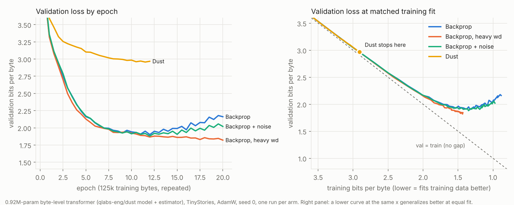

# Forward-only training (Dust) and data-efficient small LMs: GPU experiment plan

Written 2026-10-23 after a CPU pilot. Self-contained: you do not need the conversation it came from.
Everything here is a plan, except §2, which reports what was actually run.

**Contents**
1. [Background](#1-background-what-noise-and-dust-are): what Noise and Dust are, and what is and isn't established
2. [The CPU pilot](#2-what-was-already-run-the-cpu-pilot-2026-10-23) and what it taught
3. [Rules of evidence](#3-rules-of-evidence-apply-to-every-experiment) for every experiment
4. [Experiments E1–E6](#4-experiments), in recommended order
5. [Files in this directory](#5-files-in-this-directory)
6. [Sources](#6-sources)

---

## 1. Background: what Noise and Dust are

**Backpropagation** computes exact gradients with a backward pass through the network. **Forward-only**
(zeroth-order) methods estimate the gradient from forward passes alone: perturb something, see how
the loss changes, and credit the perturbation. Until recently they were considered hopeless for
pretraining, because the variance of the estimate grows with the number of parameters.

**Dust** ([research page](https://qlabs.sh/research/dust), [code](https://github.com/qlabs-eng/dust)) is
Q Labs' forward-only method. It does not perturb weights. It adds Gaussian noise to each linear layer's
*output activations*, independently at every token: `y_t → W x_t + σ a_t`. It rewards each token's noise
by the loss change at that token, and forms the estimated output error
`ĝ_t = −(1/Kσ) Σ_i r_t⁽ⁱ⁾ a_t⁽ⁱ⁾`. Each weight's gradient is then `Σ_t ĝ_t x_tᵀ`, the same outer product
backprop uses, but with the error estimated instead of chain-ruled. Because every token is its own
trial, one forward pass tests thousands of perturbations. Attention internals, the LM head and a few
residual scalars get special-cased estimators (see the docstring at the top of `dust.py` in the repo).

**Noise** ([page](https://qlabs.sh/noise), [repo](https://github.com/qlabs-eng/noise)) is Q Labs' public
benchmark for training without a backward pass.
- **Fixed setup:** a 37.7M-parameter GPT, FineWeb data, BPE-4096 tokenizer, one 8×H100 node.
- **Banned:** autograd and hand-written backward passes.
- **Allowed:** error signals measured forward, and each signal may take at most one step through a
  nonlinearity.
- **Tracks:** lowest validation loss after one epoch, speedrun to a target loss, and "open
  architecture" (Track 3).
- **Data change:** on 2026-10-22 the training set grew from 10M to 30M tokens. The 10M tracks are
  archived.

**What is established, with caveats:**
- **Rivals backprop with SGD.** Dust matches backprop under plain SGD at large populations, per Q Labs.
- **Behind backprop with Adam.** Dust with Adam reaches 3.767 (24k population, 5 h 17 min on 8×H100,
  30M tokens), while backprop with Adam reaches 3.419.
- **The forward-only record is not Dust as published.** The best forward-only Noise entry reaches
  3.409 on the 30M track. It is a community method: Hadamard-cycle probes instead of random draws,
  identity-path credit, future-token probes and an end merge. Backprop with a better optimizer
  (ANVIL II plus Adam) reaches 3.340.
- **The viral "4,000× faster" compares Dust with itself.** It is the 10M speedrun to a *loose*
  target (val loss 4.2) dropping from 1.76 h to 1.6 s, community record versus launch baseline, not
  forward-only versus backprop.
  [Independent fact-check](https://explainx.ai/blog/q-labs-dust-noise-pretrain-transformers-without-backpropagation-4000x-claim-verified-2026).
- **Not practical yet.** The authors say compute efficiency "needs orders-of-magnitude improvement"
  and that scaling is the biggest open question.
- **Speculation only:** Q Labs suggests backprop explores the loss landscape poorly, which might be
  why networks need so much data. Search-based learning might generalize better. **Nobody has tested
  this cleanly. E1 does.**

---

## 2. What was already run: the CPU pilot (2026-10-23)

**Question:** with scarce data and many epochs, does a Dust-trained model overfit less than a
backprop-trained one?

**Setup**
- **Model:** `model.py` and the `DUST` class from [qlabs-eng/dust](https://github.com/qlabs-eng/dust),
  used unchanged, shrunk to `GPTConfig(sequence_len=256, vocab_size=256, n_layer=4, n_head=4,
  n_kv_head=4, n_embd=128)`. That is a byte-level model with 0.92M parameters.
- **Data:** [TinyStories](https://huggingface.co/datasets/roneneldan/TinyStories)
  `TinyStoriesV2-GPT4-valid.txt`, deduplicated by normalized story text, then split by story into
  disjoint val, test and train sets (overlap checked: 0/0/0). Train is **125k bytes**, repeated for
  20 epochs. Val and test are about 66k bytes each.
- **Training:** batch 8×256 bytes, seed 0, AdamW (lr 3e-3, betas 0.9/0.95, constant lr).
- **Controlled:** same init, data order and optimizer in every arm. Only the gradient source differs.
- **Dust population:** about half the repo's smallest recipe. Draws per block: writers [20,16,8,8],
  hidden the same, hubs [4,4,4,4], embedding 8, head 64, local q4/v12/gate4/k8/ve4, chunk 4.
- **Metric:** bits per byte (bpb) = cross-entropy / ln 2. Lower is better, and it is comparable across
  tokenizers.

**Results**

| Arm | Best val bpb | Epoch of best | Final val − train |
|---|---|---|---|
| Backprop, weight decay 0.1 | 1.902 | 12, then overfits | 1.28 |
| Backprop + activation noise σ 0.2 on the layers Dust jitters | 1.881 | 12 | 1.05 |
| Backprop, weight decay 1.0 | **1.821** | 20, still improving | 0.39 |
| Dust, weight decay 0.1 (stopped at epoch 12) | 2.956 | 11.5, plateaued | 0.06 |



**Verdict: inconclusive.**
- **Dust plateaued before the regime that matters.** It stalled near train 2.9 bpb (0.04 bpb of
  progress over epochs 8–12), and I stopped it there. The backprop arms only differ in generalization
  once train bpb drops below about 2.1.
- **Equal gaps where Dust was measured.** At matched training fit (train ≈ 3.0 bpb), Dust's
  val − train gap was 0.054 against 0.049 for backprop, about the same.
- **Dust was very slow here.** Backprop reached Dust's final val loss in under 2 epochs (about 20 s).
  Dust needed 12 epochs and 77 min, roughly 200× slower in wall-clock time.
- **The estimate was noisy.** Its cosine similarity with the exact gradient fell from 0.9 at step 10
  to 0.13–0.3 after epoch 1.
- **The test split was never read for Dust,** because it was stopped early.

**Lessons that shape the GPU plan**
1. **Use a much smaller train set** (about 30k bytes), so backprop starts overfitting at a training
   loss Dust can actually reach.
2. **Add an lr cooldown to every arm.** A noisy estimator plateaus at a noise floor under a constant
   lr, and the Dust paper's Adam runs use a cooldown.
3. **Use a larger population and a larger batch.** The paper used 16k tokens per step; the pilot used
   2k.
4. **Prefer AdamW over the repo's SGD recipe at this scale.** With the Dust repo's tuned SGD groups
   (lr 0.175, momentum 0.98, embedding lr 1000), backprop needed about 40 epochs to reach 2.1 bpb.
   With lr 0.5 it reached 2.95 after 12 epochs, and lr 1.0 diverged. AdamW reached 1.90 in 12 epochs.
5. **Heavy weight decay is the baseline to beat,** not plain backprop. This matches
   [Kim et al., ICLR 2026](https://arxiv.org/abs/2509.14786v1), where weight decay about 30× the
   usual value improved data efficiency.
6. **Noise alone barely regularizes backprop** (1.88 vs 1.90). So a Dust win would not be explained
   away as "it's just noise", provided the noise control arm is kept.

Raw logs for every arm, including the SGD and lr sweeps, are in `pilot-cpu-20261023/runs/`. Those
runs used an earlier version of `train.py`, where `--method` took `bp_sgd`, `bp_adamw` or `bp_noise`
and the optimizer was implied by the method. Each `config.json` records what was run.

---

## 3. Rules of evidence (apply to every experiment)

- **Baselines first.** Every comparison includes:
  - plain backprop,
  - the strongest *regularized* backprop (weight-decay sweep, including about 10–30× the default),
  - a "backprop + the same noise" control whenever a forward-only method injects noise.
- **Same everything except the variable:** init, data order, optimizer family, token budget and
  schedule.
- **Seeds:** at least 3 per arm for any claim. Report mean ± std. A difference smaller than twice the
  seed std is a tie.
- **Metric:** validation **bits per byte**, never per-token loss across different tokenizers.
- **Test discipline:** select checkpoints and hyperparameters on val only. Read test once per final
  configuration, at the end.
- **Leakage checks, written down:**
  - deduplicate before splitting, and count overlap between splits,
  - make sure no teacher model was trained on the eval text,
  - make sure no child run loads a parent's weights.
- **If a result looks too good** (for example "10× data efficiency"), the first hypothesis is a bug
  or leakage. Check before believing it.
- **Pre-register success thresholds** (given per experiment below) before running.
- **Record:** git commit, exact command, seed, hardware, torch version, wall-clock time and number of
  forward passes. `train.py` writes `config.json`, `metrics.jsonl` and `result.json` per run.
- **Supervise long runs.** Run them under a watcher with a wall-clock budget. In this repo that is
  `tools/lab watch start --op NAME --budget-min N --stall-min M -- <command>`; see the repo's
  `CLAUDE.md`.

---

## 4. Experiments

Recommended order: **E3 → E1 → E2 → E4 → E5**, with **E6** independent. E3 is cheap and calibrates
the estimator, so the other experiments don't waste GPU time on a bad population size.

### E3. Estimator quality: what makes forward-only gradients good? (cheap diagnostic)

**Question:** how does the cosine similarity between the forward-only estimate and the exact gradient
scale with population size, probe type and training progress?

**Design**
- Same tiny model, plus one ≈10M-param model.
- Take checkpoints saved at several training losses from a backprop run. Exact gradients are
  computed only as a measuring stick.
- On a fixed batch, compute the cosine for:
  - **Population** K ∈ {64, 256, 1k, 4k, 16k}.
  - **Probe type:**
    - (a) random Gaussian, as in Dust;
    - (b) antithetic ± pairs;
    - (c) orthogonal draws;
    - (d) a full **Hadamard cycle**, i.e. deterministic orthogonal probes covering every neuron.
      This was the community's biggest jump on Noise.
  - **What is perturbed:** weights (SPSA/MeZO-style) versus per-token activations (Dust-style).
- Report cosine per layer type, against K and against training loss. The pilot saw the cosine
  collapse as loss fell, and this experiment measures that.

**Output:** a table of the K needed for cosine 0.3 / 0.5 / 0.8 per probe type. Use it to choose the
population for E1 and E2.

**Cost:** minutes per model on one GPU.

### E1. Does forward-only training overfit less when data is scarce? (the pilot, done properly)

**Hypothesis (Q Labs' speculation):** at equal training fit, a forward-only-trained model has lower
validation loss than a backprop-trained one.

**Design**
- **Model:** start with the pilot's 0.92M byte model, then repeat at about 10M params if the
  small-scale result is interesting.
- **Data:** TinyStories built by `prep.py`, at train sizes **30k, 125k and 500k bytes**. The 30k size
  makes backprop overfit at a train loss Dust can reach. Many epochs at each size.
- **Arms:** run all with AdamW and a cosine cooldown, 3 seeds each:
  1. `bp`, weight decay 0.1;
  2. `bp`, heavy weight decay: the best of {1.0, 3.0} on val;
  3. `bp_noise`, the noise control, with σ matched to Dust's;
  4. `dust`, at the population E3 says gives cosine ≥ 0.3 mid-training, and lr tuned on val;
  5. optional: `dust` with SGD and the repo's recipe, as in the paper.
- **Primary metric:** the val − train gap at matched train bpb levels below the onset of backprop
  overfitting. `analyze.py` prints this table, and the right panel of its figure plots it.
- **Secondary:** best val bpb achieved (lower is better regardless of the gap); wall-clock time;
  forward-pass count.

**Pre-registered decision rule**
- **"Dust generalizes better"** requires two things at once:
  - at ≥ 2 matched train levels, Dust's gap is lower than the *best regularized backprop arm's* by at
    least 0.03 bpb *and* by more than 2× the seed std;
  - Dust's best val bpb is no worse than that arm's.
- **"No"** if Dust's gap lies within that margin, or Dust can't reach the overfitting regime even at
  30k bytes. The second case gets reported as "untestable at this cost", not as a success.

**Cost:** with the pilot's settings, Dust on 4 CPU cores took about 6.5 s per step, at about 150
forward-equivalents per step. On one modern GPU expect at least 20× faster. **Measure first** with
`--max_minutes 2` before planning the grid.

### E2. An architecture designed for forward-only credit (candidate labloop campaign)

**Question:** with a fixed forward-only training method and a fixed forward-pass budget, which
architectures train best? This is Noise's Track 3 ("open architecture"), done small first.

**Candidates:**
- **Wide-shallow:** fewer, wider blocks, so error signals need fewer hops.
- **Strong identity paths:** the community's "identity-path credit" trick measures error once at the
  top and broadcasts it to every block, which only works if the residual stream carries it.
- **Looped / weight-shared blocks:** one block applied N times. That cuts params by N, and one credit
  measurement serves every application. Compare with recurrent-depth / universal-transformer
  literature.
- **Local losses:** a small auxiliary prediction head per block, so each block gets its own nearby
  error signal. The Noise rules allow forward-measured signals that take at most one nonlinear step.

**Fixed:** data, token budget, forward-only estimator, total forward-pass compute, parameter count
within ±10%. **Variable:** architecture only. Always include the unmodified Dust GPT as baseline
candidate `c0000`.

**Metric:** val bpb at a fixed budget, 3 seeds for the top candidates. **Success threshold:** beat the
unmodified Dust GPT by ≥ 0.05 bpb at equal forward-pass budget, across seeds.

**As a labloop campaign:** this fits the repo's search loop (`tools/lab run`). The baseline
candidate is the Dust GPT; workers propose architectures; fitness is val bpb on a hidden search split;
a final split is read once. Setup steps are in [`docs/campaign-setup.md`](../campaign-setup.md):
- write `campaign.toml` with `success_threshold` fixed before the run,
- write a stdlib-only evaluator `score.py`,
- put hidden labels under `$LAB_PRIVATE`,
- set up a candidate Python env with torch and CUDA,
- add a GPU entry in `resources.gpus`.

Start with a handful of candidates on a sub-hour task before any long search.

### E4. Train what backprop can't train cleanly

Forward-only estimators never differentiate the model, so they apply directly to non-differentiable
parts. Each comparison is against backprop with a **straight-through estimator** (STE), the standard
workaround.

- **E4a, ternary weights.** Weights in {−1, 0, +1} with a per-matrix scale, as in BitNet b1.58
  ([arXiv:2402.17764](https://arxiv.org/abs/2402.17764)). Compare Dust (keeping latent full-precision
  weights) against backprop + STE.
- **E4b, spiking networks.** Leaky integrate-and-fire neurons, where the spike is a step function
  with zero gradient almost everywhere. The baseline is **surrogate-gradient** backprop through time
  ([Neftci, Mostafa & Zenke 2019](https://arxiv.org/abs/1901.09948);
  [snnTorch](https://snntorch.readthedocs.io/)).
  - **Reference point** (CPU, 2026-10-23, one seed): a 784→256→10 LIF network, rate-coded MNIST with
    25 timesteps, trained with surrogate gradients and Adam for 3 epochs. It reached 97.4% test
    accuracy, against 97.0% for a same-size ReLU MLP. Hidden neurons fired on about 7% of
    neuron-timesteps.
  - **New arm:** a Dust-style estimator that jitters the membrane potential per timestep and credits
    by the loss change.
  - **Metrics:** accuracy, firing rate, and cosine with the surrogate gradient.
- **E4c, hard routing / discrete choices.** For example a top-1 mixture-of-experts router, or a
  discrete memory lookup, trained without Gumbel or STE tricks.

**Metric:** quality at an equal training budget. **Interesting if** forward-only matches or beats
STE / surrogate gradients on any of these.

### E5. Memory-light forward-only fine-tuning

**Question:** can Dust-style per-token activation perturbation fine-tune a small *pretrained* LM, on
a GPU too small for backprop fine-tuning, better than weight-space zeroth-order methods?

**Arms:**
- backprop fine-tuning (full, or LoRA if memory forces it),
- **MeZO** weight-space zeroth-order fine-tuning
  ([Malladi et al. 2023](https://arxiv.org/abs/2305.17333)),
- Dust-style activation perturbation.

**Measure:** peak memory, tokens/s, and task quality on a small instruction or classification set.
**Interesting if** Dust beats MeZO clearly at equal forward passes while using about inference-level
memory.

### E6. The "wow" demo: a tiny story model trained on very little data (independent of Dust)

**Goal:** a 10–30M-param model trained on about 5M tokens that matches a baseline trained on about
50M tokens, measured honestly.

**Background:**
- **[TinyStories](https://arxiv.org/abs/2305.07759):** models of about 1–30M params write coherent
  stories because the language is simple.
- **[Kim et al., ICLR 2026](https://arxiv.org/abs/2509.14786v1):** heavy regularization plus
  multi-epoch training plus ensembling matched the baseline with 5.17× less data. An ensemble
  distilled into an 8× smaller student kept 83% of the gain.
- **[BabyLM](https://awesomepapers.io/large-language-models/publications/warstadt2025findings):**
  10M-word budgets. New objectives and learning from a teacher model did best.
- **[Muennighoff et al. 2023](https://arxiv.org/abs/2305.16264):** repeating data for up to about 4
  epochs is nearly as good as fresh data.

**Design**
1. **Baseline data-scaling curve:** a standard GPT trained at 5, 10, 20 and 50M tokens of TinyStories,
   tuned on val at each size.
2. **Recipe arms at 5M tokens**, each added one at a time:
   - heavy weight decay plus many epochs,
   - ensembling and distilling into one model,
   - distillation from a larger open model's logits,
   - optional: looped blocks to cut params.
3. **Data-efficiency multiplier:** the number of tokens the baseline needs to match an arm's val bpb,
   read off the curve from step 1, divided by 5M.
4. **Report with and without the external teacher.** Teacher-based gains are borrowed knowledge, and
   the teacher must not have trained on the eval split.

**Expectations, honestly:** about 5× is plausible on narrow data. 10× with a teacher is possible. 100×
from architecture alone has no supporting evidence, and a measured 100× is a bug until proven
otherwise.

**Cost:** a few GPU-hours in total on a consumer GPU.

---

## 5. Files in this directory

| File | What it is |
|---|---|
| `prep.py` | Builds byte-level TinyStories splits: deduplicates, splits by story, checks overlap. `python prep.py <TinyStoriesV2-GPT4-valid.txt> <out_dir> <train_bytes>` |
| `train.py` | All arms: `--method bp \| bp_noise \| dust`, `--opt adamw \| sgd`, `--wd`, `--lr`, `--sigma`, `--epochs`, `--seed`, `--device`, `--dust-src <clone of qlabs-eng/dust>`, `--max_minutes`. Logs train-probe and val bpb, plus gradient cosine for `dust`. Test is read once at the end. |
| `analyze.py` | Results table, gap-at-matched-fit table and figure. `python analyze.py <runs_dir> <out.png>`. Arm directory names are listed in `ARMS` at the top. |
| `pilot-cpu-20261023/` | The pilot's per-arm `config.json` and `metrics.jsonl`, plus the figure. |

**Status of the code:**
- The model config and Dust recipe in `train.py` are hard-coded to the pilot's 4-layer model.
  Scaling up means editing `GPTConfig(...)` and the per-block `Recipe` lists, which must have one
  entry per layer.
- `--device cuda` is **untested**; the pilot ran on CPU only.
- Before E1, add a cosine lr cooldown, since the pilot used a constant lr.

To reproduce the pilot:

```sh
git clone https://github.com/qlabs-eng/dust
curl -L -o valid.txt https://huggingface.co/datasets/roneneldan/TinyStories/resolve/main/TinyStoriesV2-GPT4-valid.txt
python prep.py valid.txt data125k 125000
python train.py --method bp       --wd 0.1 --data data125k --out runs/A_bp_wd0.1      --epochs 20 --dust-src dust
python train.py --method bp       --wd 1.0 --data data125k --out runs/A_bp_wd1.0      --epochs 20 --dust-src dust
python train.py --method bp_noise --wd 0.1 --data data125k --out runs/A_bpnoise_wd0.1 --epochs 20 --dust-src dust
python train.py --method dust     --wd 0.1 --data data125k --out runs/A_dust_wd0.1    --epochs 20 --dust-src dust
python analyze.py runs fig.png
```

---

## 6. Sources

- Noise benchmark: [qlabs.sh/noise](https://qlabs.sh/noise) · [github.com/qlabs-eng/noise](https://github.com/qlabs-eng/noise)
- Dust: [qlabs.sh/research/dust](https://qlabs.sh/research/dust) · [github.com/qlabs-eng/dust](https://github.com/qlabs-eng/dust)
- Fact-check of the "4,000×" claim: [explainx.ai](https://explainx.ai/blog/q-labs-dust-noise-pretrain-transformers-without-backpropagation-4000x-claim-verified-2026)
- Kim, Kotha, Liang, Hashimoto, *Pre-training under infinite compute*, ICLR 2026: [arXiv:2509.14786](https://arxiv.org/abs/2509.14786v1)
- Eldan & Li, *TinyStories*: [arXiv:2305.07759](https://arxiv.org/abs/2305.07759) · [dataset](https://huggingface.co/datasets/roneneldan/TinyStories)
- BabyLM findings: [summary](https://awesomepapers.io/large-language-models/publications/warstadt2025findings)
- Muennighoff et al., *Scaling Data-Constrained Language Models*: [arXiv:2305.16264](https://arxiv.org/abs/2305.16264)
- Malladi et al., *Fine-Tuning Language Models with Just Forward Passes* (MeZO): [arXiv:2305.17333](https://arxiv.org/abs/2305.17333)
- Ma et al., *The Era of 1-bit LLMs* (BitNet b1.58): [arXiv:2402.17764](https://arxiv.org/abs/2402.17764)
- Neftci, Mostafa, Zenke, *Surrogate Gradient Learning in Spiking Neural Networks*: [arXiv:1901.09948](https://arxiv.org/abs/1901.09948) · [snnTorch](https://snntorch.readthedocs.io/)
